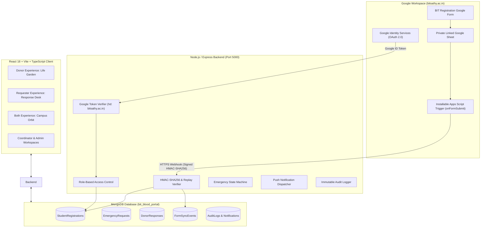
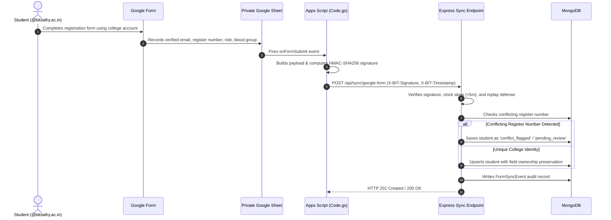
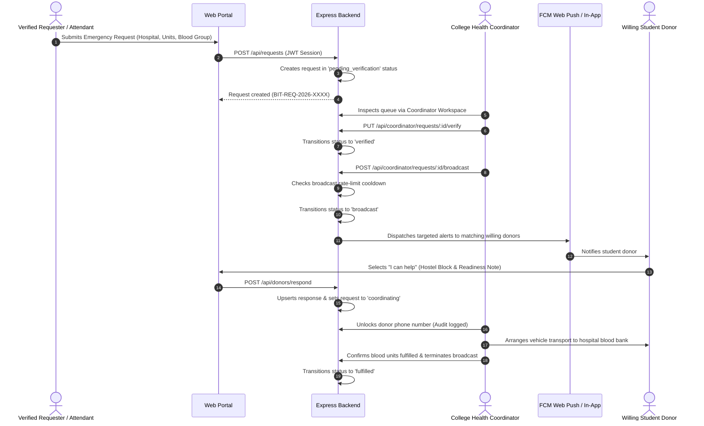
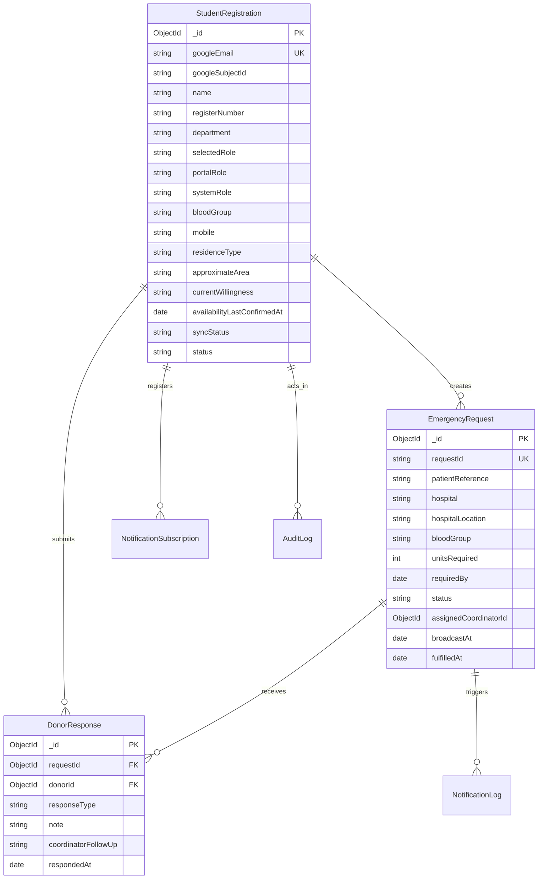

# Architecture and Data Flow Specification
## BIT Digital Blood Donation & Emergency Availability Management Portal

---

### 1. High-Level System Architecture

---

### 2. Google Form Submission & Webhook Sync Sequence

---

### 3. Emergency Request & Coordination Sequence

---

### 4. Database Entity-Relationship Overview

